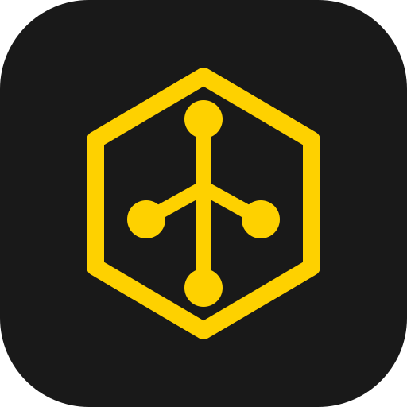
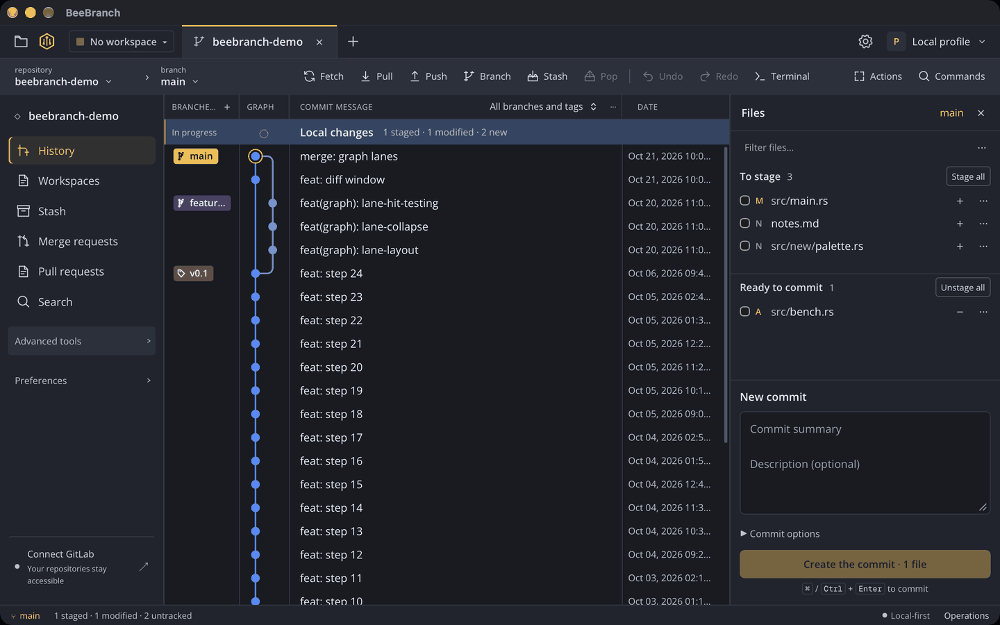
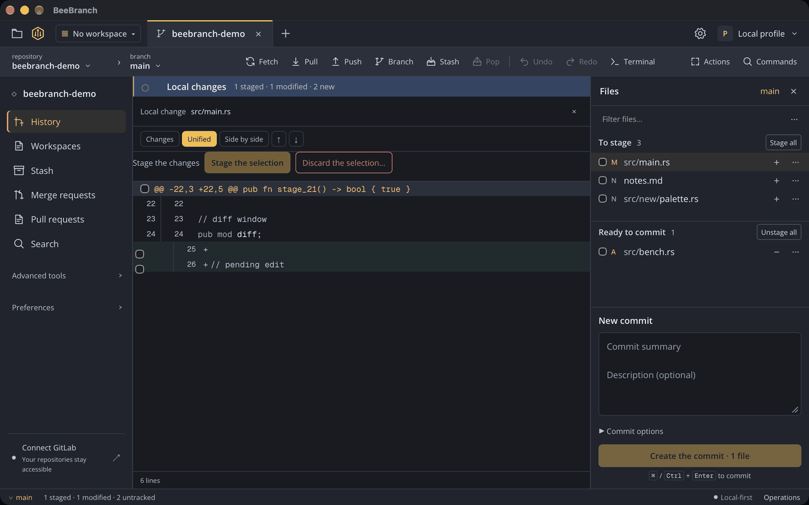
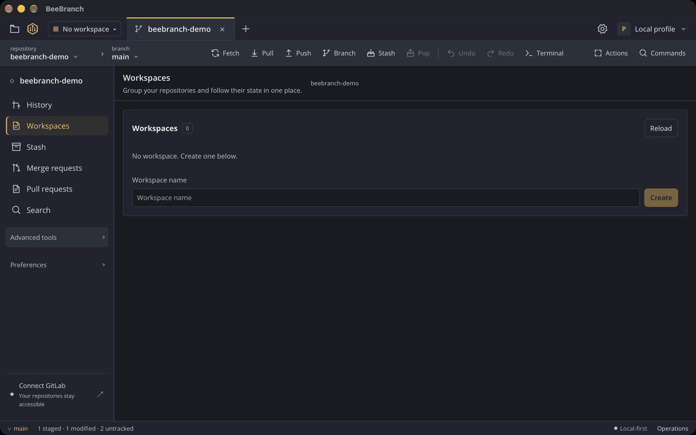
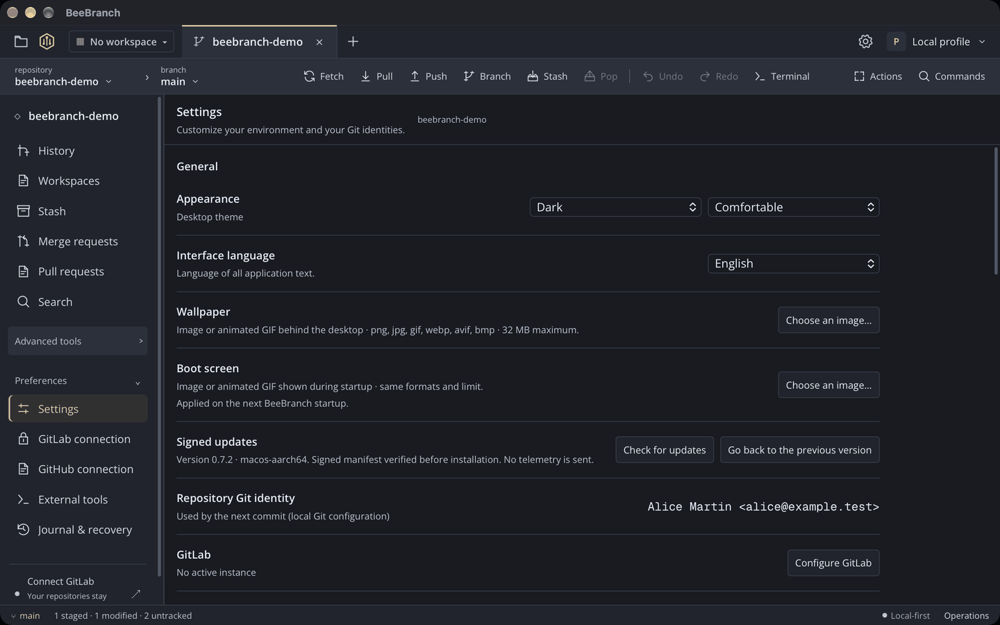
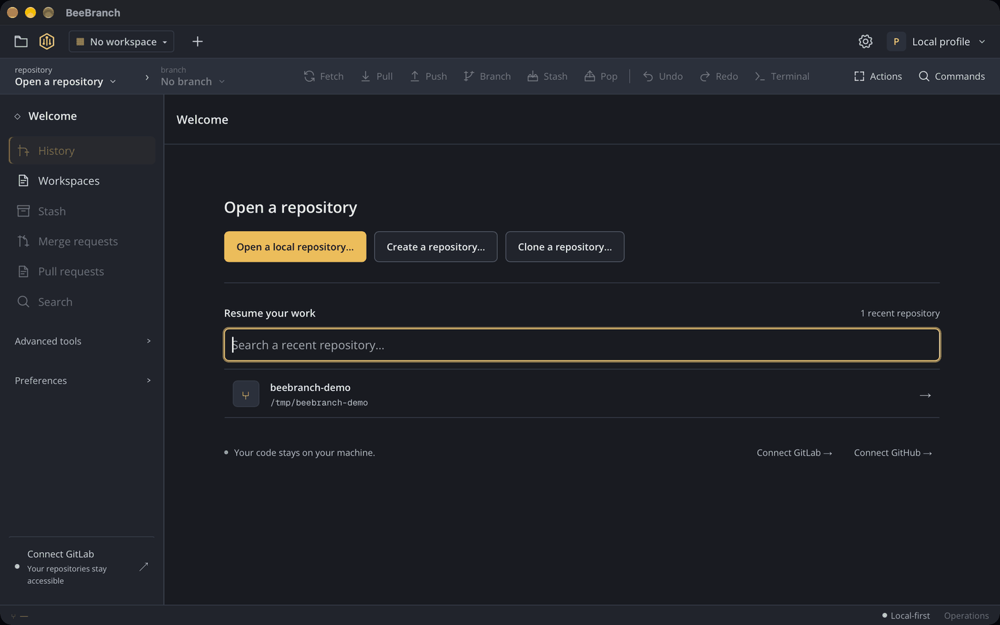
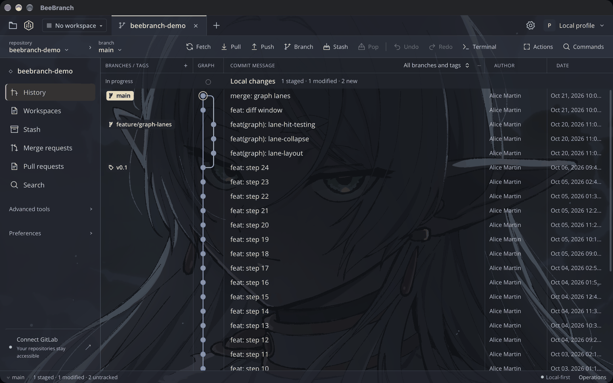
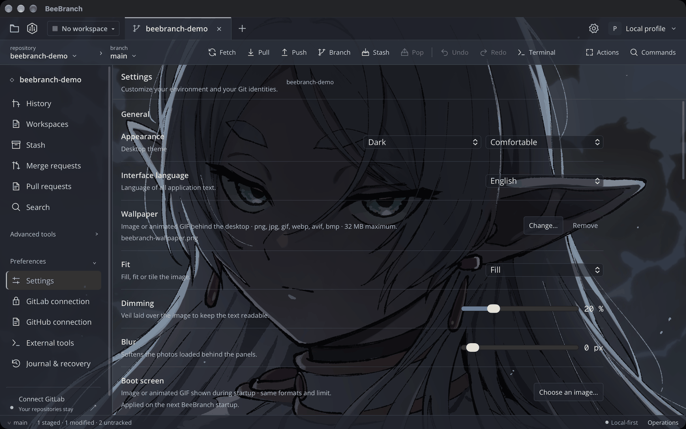
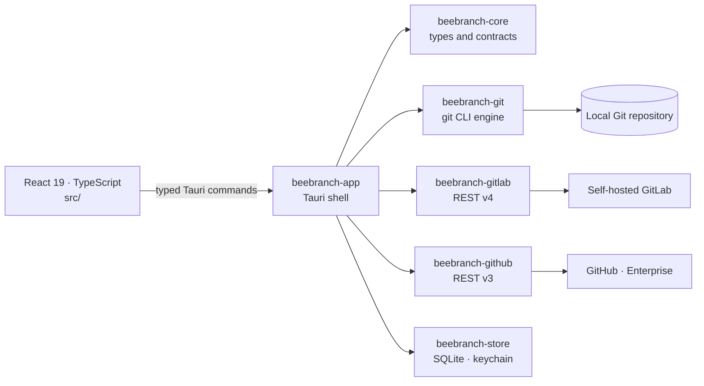

<div align="center">



<h1>BeeBranch</h1>

<p><strong>The local-first desktop Git client.</strong><br />
Rust · Tauri 2 · React 19 — your repositories stay the only source of truth.</p>

<p>
<a href="https://github.com/Methamorphe/beebranch/actions/workflows/ci.yml"></a>
<a href="https://github.com/Methamorphe/beebranch/actions/workflows/release.yml"></a>
<a href="https://github.com/Methamorphe/beebranch/releases/latest"></a>
<a href="LICENSE"></a>
<a href="#download"></a>
</p>

<p>
<a href="https://www.rust-lang.org/"></a>
<a href="https://tauri.app/"></a>
<a href="https://react.dev/"></a>
</p>

<p>An open-source alternative to commercial Git clients, built for teams working<br />
with <strong>self-hosted GitLab</strong> and <strong>GitHub</strong>: no proprietary cloud,<br />
no vendor account, no telemetry and no AI.</p>

</div>



---

## Screenshots

| Changes and staging | Workspaces |
| :---: | :---: |
|  |  |
| **Settings, themes and profiles** | **Home and repository opening** |
|  |  |

**Custom wallpaper** — a local image behind the graph, configured from the
appearance settings:

| Graph | Settings |
| :---: | :---: |
|  |  |

> Captures of the desktop application (macOS build, English interface, dark
> theme) with a demo repository.

## Download

Releases are published in this repository:
<https://github.com/Methamorphe/beebranch/releases/latest>

| Platform              | Artefact                                                                                                        |
| --------------------- | --------------------------------------------------------------------------------------------------------------- |
| macOS (Apple Silicon) | `BeeBranch_<version>_aarch64.dmg` — signed with `Developer ID Application`, notarised and stapled               |
| Windows (x64)         | `BeeBranch_<version>_x64-setup.exe` — NSIS installer, Authenticode signature when the certificate is configured |
| Linux (x86_64)        | `.AppImage`, `.deb` or `.rpm`                                                                                   |

**Requirements:** Git ≥ 2.34.

Subsequent updates are installed by the application from
**Settings → Updates**, after the artefact signature is verified. The previous
version remains installable (`rollback.json`).

If your platform or architecture is not in the matrix (macOS Intel, for
example), [build from source](#development).

## Features

### Repositories and workspaces

- Open a local repository, clone from GitLab/GitHub or a URL, create one with
  `git init` in a new folder or an existing unversioned folder.
- Multi-repository workspaces, tabs, isolated sessions, active tab restored.
- Repository identity and **worktree-aware** sessions.

### Local work

- **Status**: staged/unstaged/untracked/conflicted files, list or tree view,
  stage/unstage by file, hunk or line, confirmed discard, explicit ignore,
  external editor and merge tool, blame.
- **Commit**: message, amend, hooks displayed, Git signing respected.
- **Stash, tags, worktrees, submodules, patches, profiles**.

### History and branches

- Create, check out, rename, delete with name confirmation, upstream,
  A→B comparison, merge/rebase, conflicts, continue/skip/abort, drag and drop.
- **Graph**: virtualised canvas rendering, filters, context menu, MR/CI badges,
  stash across all refs.
- **Search**: message/author/SHA, announced depth, cancellation.

### Synchronization

- Streamed fetch/pull/push, cancellation, explicit `force-with-lease`,
  progress and remote revalidation.
- **Explicit undo/redo**: a matrix of operations that Git can reverse, with no
  application-level backups
  ([ADR-0008](docs/adr/0008-no-application-backups.md)).
- **Crash recovery**: operation journal, destructive actions traced.

### GitLab and GitHub

| GitLab                                                                | GitHub                                                                                            |
| --------------------------------------------------------------------- | ------------------------------------------------------------------------------------------------- |
| Merge requests (mine, to review, assigned, project), detail, creation | Pull requests, detail, creation                                                                   |
| Pipelines, CI badge, repository ↔ project matching                    | Reviews and approvals, review comments, CI checks and Actions logs, repository ↔ project matching |

- Personal Access Token authentication, stored in the OS keychain.
- **"Use my Git credentials"**: reuses `git credential fill` (macOS Keychain,
  Windows Credential Manager, `gh auth git-credential`) without copying the
  secret into the application.
- Self-hosted GitLab and GitHub Enterprise Server, graceful offline
  degradation.

### Appearance

- **Custom wallpaper**: a local image or animated GIF behind the interface,
  with fit (cover/contain/tile), dim and blur controls, plus a custom splash
  image.
- Light and dark themes, comfortable and compact density, French and English
  interface, reduced-motion support.

### Security and reliability

- **minisign** updates verified before installation, tool-assisted rollback.
- Mutations serialised per repository, streaming for long operations, no large
  IPC payloads
  ([ADR-0005](docs/adr/0005-per-repo-serialization-and-ipc.md)).
- Preflight checks, confirmations for destructive actions, secrets in the OS
  keychain, verified TLS.
- **Zero telemetry, zero AI.** The network is only used for Git, the
  GitLab/GitHub APIs and the update manifest.

## Development

Requirements: **Rust ≥ 1.85**, **Node ≥ 22**, **Git ≥ 2.34** and the
[Tauri 2](https://tauri.app/start/prerequisites/) system dependencies.

```bash
npm install
npm run tauri dev
```

Local production build (without release signing):

```bash
npm run tauri build
```

The release pipeline (macOS signing, notarisation, minisign artefacts,
manifests and rollback) is described in
[docs/releases/README.md](docs/releases/README.md).

### Checks

```bash
npm run lint
npm run build
npm run audit:telemetry
cargo fmt --all -- --check
cargo clippy --workspace --all-targets -- -D warnings
cargo test --workspace
```

Headless UI test — exercises the graph, the diff and the main views, then
writes screenshots to `target/ui-smoke/`:

```bash
npm run ui:smoke
```

### Benchmarks

Performance budgets come from reproducible measurements, not estimates
([ADR-0003](docs/adr/0003-benchmark-first-and-canvas.md)).

```bash
cargo run -p beebranch-bench --release -- \
  --root target/bench-corpus --all-reduced \
  --runs 5 --warmup 2 \
  --out target/bench-report.json \
  --baseline crates/bench/baselines/ci.json --assert
```

Targeted scenarios and corpus: [crates/bench/README.md](crates/bench/README.md).

## Architecture



```text
crates/
  core/       shared types and UI contracts
  git/        Git process, index/commit/branches/sync/history/stash/search, lanes
  gitlab/     REST v4 client, URL/CA, ETag cache, remote matching
  github/     REST v3 client, GitHub Cloud/Enterprise, checks, Actions, remotes
  store/      SQLite (journal, cache, preferences) and keychain
  app/        Tauri shell: typed commands, setup, logging, recovery
  bench/      deterministic corpus, PERF scenarios, reports and thresholds
src/
  components/ reusable components
  hooks/      presentation hooks
  data/       static UI data
  styles/     tokens and global styles
src-tauri/    Tauri bootstrap and configuration
```

To regenerate the icons after changing the logo:

```bash
npm run tauri icon assets/beebranch.svg
```

## Contributing and security

Contributions are accepted **exclusively through merge requests** (GitHub pull
requests): `main` is protected and direct pushes are not allowed. Every commit
must carry a `Signed-off-by` trailer (DCO 1.1) and CI must pass.

- [CONTRIBUTING.md](CONTRIBUTING.md): environment, conventions, scope,
  verification and evidence requirements.
- [SECURITY.md](SECURITY.md): private vulnerability reporting, threat model
  and support scope.
- [CODE_OF_CONDUCT.md](CODE_OF_CONDUCT.md): code of conduct.

## License

BeeBranch is distributed under the **GNU Affero General Public License v3.0**
(`AGPL-3.0-only`, see [LICENSE](LICENSE)). Any modified version that is
distributed or exposed as a service must publish its corresponding source
code.

Copyright © 2026 Methamorphe.

BeeBranch trademarks, logo and visual assets are not covered by the code
license: their reuse must be requested from the maintainers.
