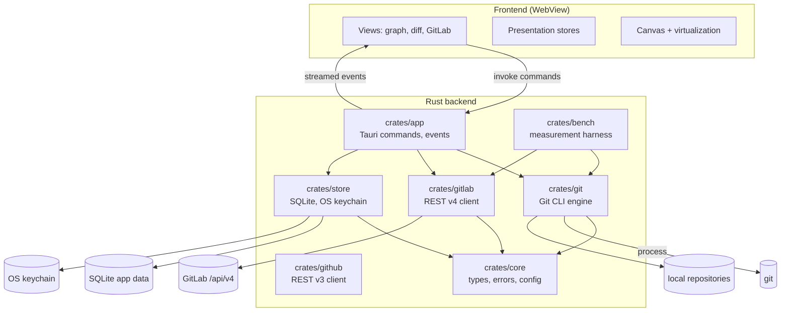
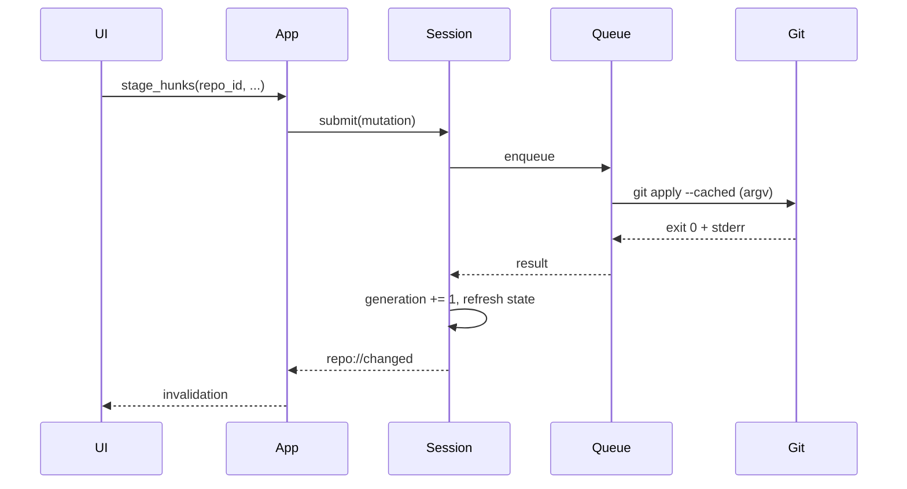

# 02 — Target architecture

## 1. Overview

Tauri 2 desktop application, Rust backend, web frontend. The backend is the only component that talks to Git, the file system, the OS keychain, and GitLab. The frontend only presents information and triggers typed commands.



## 2. Code organization

```
beebranch/
  Cargo.toml                 # workspace
  crates/
    core/                    # shared types, errors, configuration
    git/                     # sole owner of the `git` process
    gitlab/                  # REST v4 client
    github/                  # REST v3 client (Cloud and Enterprise)
    store/                   # local persistence, keychain
    app/                     # Tauri shell, commands, events
    bench/                   # harness and measurement scenarios
  src/                       # frontend (framework to be confirmed)
  src-tauri/                 # Tauri configuration, capabilities, icons
  docs/
```

### Dependency rules

| Crate | May depend on | Must never depend on |
|---|---|---|
| `core` | generic libraries (`serde`, `thiserror`) | `git`, `gitlab`, `github`, `store`, `app` |
| `git` | `core` | `gitlab`, `github`, `app` |
| `gitlab` | `core` | `git`, `github`, `app` |
| `github` | `core` | `git`, `gitlab`, `app` |
| `store` | `core` | `git`, `gitlab`, `github`, `app` |
| `app` | all | — |
| `bench` | `git`, `gitlab`, `core` | `app` (except a dedicated measurement binary) |

No cycles. No abstractions such as `GitBackend` or `GitProvider`: modules are concrete.

## 3. Modules and responsibilities

### `crates/core`

| Item | Responsibility |
|---|---|
| `ids` | `RepoId`, `OperationId`, `ProjectId`, `MergeRequestIid` — serializable opaque types |
| `repo` | `RepoPath`, `WorktreePath`, `CommonDir`, path validation |
| `state` | `RepoState`, `HeadState`, `InProgressOperation`, `ConflictSet` |
| `error` | `AppError`, categories, stable codes, remediation |
| `config` | preference schema, schema version, migrations |
| `pagination` | `PageRequest`, `Page<T>`, cursors |
| `http_cache` | `CachedResponse`, `ResponseCache` shared by the GitLab and GitHub clients |
| `time` | UTC timestamp, formatting |

Forbidden: I/O, process spawning, HTTP, OS keychain access.

### `crates/git`

The only crate allowed to launch `git`.

| Submodule | Responsibility |
|---|---|
| `process` | `CommandSpec`, argv construction, environment, timeout, streaming, cancellation, bounded capture |
| `discover` | opening a repository, worktree, common dir, bare, submodule |
| `refs` | branches, tags, remotes, upstream, HEAD |
| `status` | `--porcelain=v2 -z` parsing, index, untracked, conflicts |
| `log` | commit pages, parents, topology, filtering |
| `diff` | commit/commit diff, working tree, index, modes, limits |
| `index` | file/hunk/line staging, patch application, discard |
| `commit` | commit, amend, signing, hooks |
| `sync` | fetch, pull, push, clone, progress |
| `history_ops` | merge, rebase, cherry-pick, revert, reset soft/mixed, continue/abort |
| `integration` | preview and execution of a branch→branch drop (merge/rebase) |
| `undo` | fingerprints, preconditions, typed inverses, step-by-step restoration |
| `stash` | create, list, apply, pop, drop |
| `worktree` | list, add, remove, lock |
| `submodule` | status, init, update |
| `lfs` | detection and delegation |
| `state` | detection of intermediate states and interrupted operations |
| `capability` | Git version, supported options |

Forbidden: UI logic, HTTP access, preference storage, knowledge of GitLab.

### `crates/gitlab`

| Submodule | Responsibility |
|---|---|
| `client` | reqwest, base URL, TLS, retries, pagination, rate limit |
| `auth` | PAT, validation, expiration detection |
| `projects` | listing, search, groups, repository association |
| `merge_requests` | listing, details, diffs, creation, merge, approvals |
| `pipelines` | status, jobs, logs |
| `models` | serialized types, mapping to `core` |
| `cache` | ETag, TTL, invalidation |

Forbidden: spawning Git, direct repository access, token storage outside the OS keychain.

### `crates/github`

Symmetric with `crates/gitlab`, with no dependency between the two crates.

| Submodule | Responsibility |
|---|---|
| `client` | reqwest, GitHub Cloud/Enterprise, retries, `Link` pagination, rate limit |
| `models` | normalized types identical to GitLab DTOs to share the UI |
| `remote` | remote normalization and `owner/repo` matching |
| `pipeline` | mapping check-runs / Actions jobs to shared CI states |
| `url` | `api.github.com` or `<host>/api/v3`, reject `http` and credentials |

Accepted limitations: thread resolution, auto-merge, and branch deletion
on merge are not exposed by the REST API used; the UI hides
these actions for GitHub.

### `crates/store`

- Application SQLite: preferences, recent repositories, forge associations
  (GitLab/GitHub, `provider` column), HTTP cache, operation journal,
  undo/redo journal, and local workspaces.
- OS keychain: tokens and secrets (`beebranch.gitlab`, `beebranch.github`).
- Versioned migrations, transactions, WAL.
- No repository files modified.

### `crates/app`

- Tauri bootstrap, windows, menus, capabilities.
- Splash screen (`splash.rs`): the main window is created hidden,
  a small frameless window displays the logo animation and is then released
  by the `app_ready` command (minimum 1.5 s, fallback at 8 s if the frontend does
  not respond).
- Application state: session registry, operation registry, GitLab client, store.
- Tauri commands and event emission.
- `AppError` → stable payload mapping.
- No Git logic: delegates to `git`.

### Frontend

| Layer | Responsibility |
|---|---|
| `views` | Home, repository, graph, diff, GitLab, settings |
| `components` | Canvas graph, diff, virtualized lists, dialogs |
| `stores` | Presentation state, selection, filters, UI preferences |
| `ipc` | Generated/manual typed client, error handling |
| `workers` | Heavy text analysis if needed (highlighting), never Git access |

Forbidden: FS access, shell, GitLab HTTP, token storage, mutation logic.

## 4. Backend / frontend boundaries (IPC)

### Commands

All commands are typed, versioned, and return `Result<T, AppError>`.

| Domain | Commands |
|---|---|
| Repository | `repo_open`, `repo_close`, `repo_list_recent`, `repo_get_state`, `repo_refresh` |
| Read | `status_get`, `log_page`, `commit_get`, `diff_get`, `file_history_get`, `blame_get` |
| Index | `stage_paths`, `unstage_paths`, `stage_hunks`, `discard_paths`, `discard_hunks` |
| Commit | `commit_create`, `commit_amend` |
| Refs | `branch_create`, `branch_checkout`, `branch_rename`, `branch_delete`, `tag_create`, `remote_*` |
| Sync | `fetch_start`, `pull_start`, `push_start`, `clone_start` |
| History | `merge_start`, `rebase_start`, `rebase_interactive_start`, `cherry_pick_start`, `revert_start`, `reset_start`, `operation_continue`, `operation_abort` |
| Stash | `stash_create`, `stash_apply`, `stash_pop`, `stash_drop` |
| Worktree | `worktree_list`, `worktree_add`, `worktree_remove`, `worktree_lock` |
| Operations | `operation_cancel`, `operation_get`, `undo_status`, `undo_list`, `undo_apply`, `redo_apply`, `undo_failed`, `undo_acknowledge` |
| Integration | `branch_integration_preview`, `branch_integration_start` |
| Workspaces | `workspace_list`, `workspace_create`, `workspace_rename`, `workspace_delete`, `workspace_add_repo`, `workspace_remove_repo`, `workspace_status`, `workspace_sync` |
| Distribution | `update_status`, `update_check`, `update_install`, `update_rollback` |
| Undo | `undo_apply`, `redo_apply` (typed Git inverses, SQLite journal) |
| GitLab | `gitlab_configure`, `gitlab_validate`, `gitlab_projects_page`, `gitlab_mr_page`, `gitlab_mr_get`, `gitlab_mr_create`, `gitlab_mr_diffs`, `gitlab_pipelines` |
| GitHub | `github_configure`, `github_validate`, `github_projects_page`, `github_pr_page`, `github_pr_get`, `github_pr_create`, `github_pr_checks`, `github_merge_pr` |
| Diagnostics | `diagnostics_export` (redacted) |

### Events

| Event | Payload | Usage |
|---|---|---|
| `repo://changed` | `{ repo_id, generation, areas }` | targeted invalidation |
| `op://progress` | `{ operation_id, phase, percent?, message? }` | fetch/push/clone |
| `op://output` | `{ operation_id, stream, chunk }` | hook logs, progress |
| `op://done` | `{ operation_id, result }` | completion |
| `op://error` | `{ operation_id, error }` | failure |
| `gitlab://auth-expired` | `{ instance_id }` | GitLab reauthentication |
| `github://auth-expired` | `{ instance_id }` | GitHub reauthentication |
| `repo://state-changed` | `{ repo_id, state }` | conflict/rebase detected |

### IPC rules

1. **No payload larger than 1 MiB.** Pages are sized to stay below this limit; size is adaptive and measured.
2. **No per-commit exchanges.** A page contains N commits with parents, refs, and compact metadata.
3. **No full diff** for a file beyond the cap: hunk pagination, explicit truncation.
4. **Generations.** Each read response carries the repository's `generation`; the frontend ignores a response older than the current generation.
5. **Cancellation.** Any long-running operation can be canceled; the resulting status is revalidated and displayed.
6. **Errors.** The frontend never parses `stderr`: it displays `AppError.message` and `AppError.remediation`, and can open the raw details.

## 5. State and lifecycle

### Repository session

```rust
struct RepoSession {
    id: RepoId,
    worktree: PathBuf,
    common_dir: PathBuf,
    generation: AtomicU64,
    state: RwLock<RepoState>,
    mutations: mpsc::Sender<Mutation>,
    watcher: WatcherHandle,
    caches: RepoCaches,
}
```

Creation:

1. path validation;
2. `git rev-parse --show-toplevel --git-common-dir --is-bare-repository`;
3. worktree/submodule detection;
4. structural status loading;
5. watcher startup;
6. session publication.

Closing: cancel operations, stop the watcher, flush the cache, remove from the registry.

### Git status

Do not model status as a simple exclusive enumeration: a repository can have a rebase in progress **and** conflicts.

```rust
struct RepoState {
    head: HeadState,                      // Branch { name, upstream } | Detached { sha } | Unborn
    operation: Option<InProgressOperation>, // Merge | Rebase | CherryPick | Revert | Bisect
    conflicts: ConflictSet,               // files + available stages
    worktree: WorktreeState,              // clean | dirty | untracked | mixed
    sequencer: Option<SequencerState>,    // cherry-pick/revert multi-commits
}
```

Detected by inspecting `.git` (standard files and directories) and through `git status --porcelain=v2`. Status is recalculated after each mutation and after any detected external change.

### Invalidation

- Every mutation increments `generation`.
- The watcher triggers a debounce (150 ms) followed by targeted invalidation (`refs`, `index`, `worktree`, `head`).
- Caches are indexed by `(repo_id, generation, area)`.
- An external change (terminal, IDE, agent) is detected by fingerprint comparison and invalidates the same areas.

## 6. Concurrency and operations



- **One mutation queue per repository**. Mutations are executed strictly in submission order.
- **Reads**: concurrent while no mutation is in progress; blocked during a destructive mutation (reset, checkout, merge).
- **Long-running operations**: fetch/push/clone are queued operations; they stream and can be canceled.
- **External lock**: existing `index.lock` or `HEAD.lock` → `RepoBusy` error with remediation, never automatic deletion.
- **Timeout**: by default, no timeout on fetch/push/clone (slow network), but a progress heartbeat; timeout on local commands (30 s) with cancellation.
- **Crash**: operation journal in SQLite; on startup, `running` operations are marked interrupted and repository status is revalidated.

## 7. Error model

```rust
struct AppError {
    code: &'static str,          // stable, e.g. "git.non_fast_forward"
    category: ErrorCategory,     // Input | Repo | GitState | GitExit | Auth | Network | Tls | Conflict | Permission | Busy | Internal | Cancelled
    message: String,             // French, actionable
    detail: Option<String>,      // bounded, redacted stderr
    remediation: Option<String>, // proposed action
    retryable: bool,
    operation_id: Option<OperationId>,
}
```

Rules:

- `code` is stable and tested; the UI can rely on it, never on the text.
- `stderr` is bounded (e.g., 16 KiB) and redacted (tokens, URLs with credentials, sensitive paths).
- Known Git errors are mapped (table in [03-git-engine](03-git-engine.md#12-error-mapping)).
- An unknown error becomes `git.exit_unknown` with the exit code and raw output.
- No error is swallowed: partial operations are always reported.

## 8. Security

| Boundary | Measure |
|---|---|
| Webview | Restrictive CSP, no remote content, external links via allowlist |
| Commands | argv only, subcommand and option allowlist, never a shell |
| Paths | canonicalization, check that the path is a repository/worktree, reject unexpected symbolic links |
| Secrets | OS keychain; never in the frontend, logs, remote URLs, or crash reports |
| TLS | verification enabled; custom CA can be imported; no silent disabling |
| Logs | centralized redaction; configurable level; local export only |
| Dependencies | pinned versions, audit, no unmaintained crate without justification |
| Updates | signed binaries, signature verification |

Details: [07-reliability-security](07-reliability-security.md).

## 9. Configuration and storage

| Data | Location |
|---|---|
| UI preferences, theme, shortcuts | SQLite `app.db` |
| Recent repositories, tabs | SQLite |
| Repository ↔ GitLab project associations | SQLite |
| GitLab cache (ETag, pages) | SQLite, TTL |
| Operation journal | SQLite, rotation |
| PAT and secrets | OS keychain |
| Logs | App data directory, rotation |

No writes to `.git` outside normal Git commands. No writes to the working tree outside requested mutations.

**No application backup of the working tree.** Destructive actions (discard, `reset --hard`, stash drop) are irreversible and require explicit confirmation. Git objects remain recoverable through the reflog when created by a Git operation, but the application does not copy files or the index to restore an earlier state.

## 10. Frontend

- Graph rendering in **canvas**, strict virtualization, lanes calculated in Rust.
- Virtualized lists for files, commits, MRs.
- Bounded syntax highlighting: beyond a threshold, text rendering without highlighting.
- No durable business state in the frontend; everything is revalidated through the backend.
- Components know neither Git nor GitLab: they consume serialized `core` types.
- Framework: **React 19.3 + TypeScript + Vite** ([ADR-0006](adr/0006-react-frontend.md)). The framework must not change the backend/IPC boundaries above.

## 11. Observability

- Rust-side `tracing`: spans per command, duration, exit code, I/O size.
- Frontend `performance.mark/measure` marks: first paint, first commit page, frame budget.
- Counters: number of Git invocations, IPC bytes, cache sizes.
- No automatic network transmission. Redacted diagnostics export on explicit action.
- Benchmarks produce a versioned, comparable JSON report.

## 12. Cross-platform constraints

| Platform | Points to watch |
|---|---|
| Windows | `CREATE_NO_WINDOW`, long paths, CRLF, `core.autocrlf`, terminals, antivirus on spawn |
| macOS | signing/notarization, `/Users` paths, OS keychain, WebKit |
| Linux | WebKitGTK versions, themes, OS keychain (Secret Service), packaging |

Integration tests and benchmarks run on all three OSes in CI before every release.

## 13. Migration and compatibility

- **Greenfield**: no existing code or application data to migrate.
- **Git repositories**: never migrated, never rewritten, never moved without explicit action.
- **Historical incumbent client**: no preference or history import in the MVP; users reconfigure their identity and remotes.
- **Application database**: versioned, reversible SQLite migrations, refuse to start on a schema newer than the binary.
- **Git**: minimum 2.34 + feature detection; blocking message if insufficient.
- **GitLab**: latest three maintained versions tested + feature detection; no GitLab data migration.
