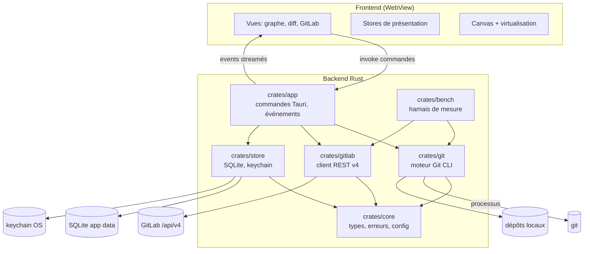
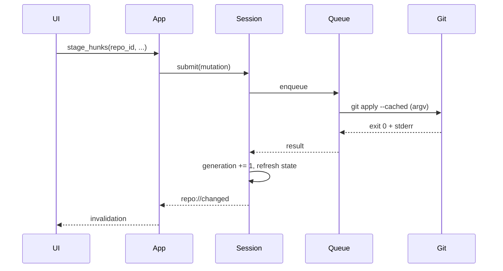

# 02 — Architecture cible

## 1. Vue d'ensemble

Application desktop Tauri 2, backend Rust, frontend web. Le backend est le seul à parler à Git, au système de fichiers, au keychain et à GitLab. Le frontend ne fait que présenter et déclencher des commandes typées.



## 2. Organisation du code

```
beebranch/
  Cargo.toml                 # workspace
  crates/
    core/                    # types partagés, erreurs, configuration
    git/                     # unique propriétaire du processus `git`
    gitlab/                  # client REST v4
    store/                   # persistance locale, keychain
    app/                     # shell Tauri, commandes, événements
    bench/                   # harnais et scénarios de mesure
  src/                       # frontend (framework à confirmer)
  src-tauri/                 # configuration Tauri, capabilities, icônes
  docs/
```

### Règles de dépendance

| Crate | Peut dépendre de | Ne doit jamais dépendre de |
|---|---|---|
| `core` | bibliothèques génériques (`serde`, `thiserror`) | `git`, `gitlab`, `store`, `app` |
| `git` | `core` | `gitlab`, `app` |
| `gitlab` | `core` | `git`, `app` |
| `store` | `core` | `git`, `gitlab`, `app` |
| `app` | toutes | — |
| `bench` | `git`, `gitlab`, `core` | `app` (sauf binaire de mesure dédié) |

Aucun cycle. Aucune abstraction de type `GitBackend` ou `GitProvider` : les modules sont concrets.

## 3. Modules et responsabilités

### `crates/core`

| Élément | Responsabilité |
|---|---|
| `ids` | `RepoId`, `OperationId`, `ProjectId`, `MergeRequestIid` — types opaques sérialisables |
| `repo` | `RepoPath`, `WorktreePath`, `CommonDir`, validation de chemin |
| `state` | `RepoState`, `HeadState`, `InProgressOperation`, `ConflictSet` |
| `error` | `AppError`, catégories, codes stables, remédiation |
| `config` | schéma des préférences, version de schéma, migrations |
| `pagination` | `PageRequest`, `Page<T>`, curseurs |
| `time` | horodatage UTC, formatage |

Interdit : I/O, spawn de processus, HTTP, accès keychain.

### `crates/git`

Seul crate autorisé à lancer `git`.

| Sous-module | Responsabilité |
|---|---|
| `process` | `CommandSpec`, construction argv, environnement, timeout, streaming, annulation, capture bornée |
| `discover` | ouverture d'un dépôt, worktree, common dir, bare, submodule |
| `refs` | branches, tags, remotes, upstream, HEAD |
| `status` | parsing `--porcelain=v2 -z`, index, untracked, conflits |
| `log` | pages de commits, parents, topologie, filtrage |
| `diff` | diff commit/commit, working tree, index, modes, limites |
| `index` | staging par fichier/hunk/ligne, patch application, discard |
| `commit` | commit, amend, signature, hooks |
| `sync` | fetch, pull, push, clone, progress |
| `history_ops` | merge, rebase, cherry-pick, revert, reset soft/mixed, continue/abort |
| `integration` | aperçu et exécution d'un drop branche→branche (merge/rebase) |
| `undo` | empreintes, préconditions, inverses typés, restauration pas à pas |
| `stash` | create, list, apply, pop, drop |
| `worktree` | list, add, remove, lock |
| `submodule` | status, init, update |
| `lfs` | détection et délégation |
| `state` | détection des états intermédiaires et des opérations interrompues |
| `capability` | version Git, options supportées |

Interdit : logique UI, accès HTTP, stockage de préférences, connaissance de GitLab.

### `crates/gitlab`

| Sous-module | Responsabilité |
|---|---|
| `client` | reqwest, base URL, TLS, retries, pagination, rate limit |
| `auth` | PAT, validation, détection d'expiration |
| `projects` | liste, recherche, groupes, association dépôt |
| `merge_requests` | liste, détail, diffs, création, merge, approvals |
| `pipelines` | statut, jobs, logs |
| `models` | types sérialisés, mapping vers `core` |
| `cache` | ETag, TTL, invalidation |

Interdit : spawn Git, accès direct aux dépôts, stockage du token hors keychain.

### `crates/store`

- SQLite applicatif : préférences, dépôts récents, associations GitLab, cache HTTP, journal d'opérations, journal undo/redo et workspaces locaux.
- Keychain OS : tokens et secrets.
- Migrations versionnées, transactions, WAL.
- Aucun fichier de dépôt modifié.

### `crates/app`

- Bootstrap Tauri, fenêtres, menus, capabilities.
- État applicatif : registre de sessions, registre d'opérations, client GitLab, store.
- Commandes Tauri et émission d'événements.
- Mapping `AppError` → payload stable.
- Aucune logique Git : délègue à `git`.

### Frontend

| Couche | Responsabilité |
|---|---|
| `views` | Accueil, dépôt, graphe, diff, GitLab, réglages |
| `components` | Graphe canvas, diff, listes virtualisées, dialogues |
| `stores` | État de présentation, sélection, filtres, préférences UI |
| `ipc` | Client typé généré/manuel, gestion d'erreurs |
| `workers` | Analyse de texte lourde si nécessaire (coloration), jamais d'accès Git |

Interdit : accès FS, shell, HTTP GitLab, stockage de token, logique de mutation.

## 4. Frontières backend / frontend (IPC)

### Commandes

Toutes les commandes sont typées, versionnées et renvoient `Result<T, AppError>`.

| Domaine | Commandes |
|---|---|
| Dépôt | `repo_open`, `repo_close`, `repo_list_recent`, `repo_get_state`, `repo_refresh` |
| Lecture | `status_get`, `log_page`, `commit_get`, `diff_get`, `file_history_get`, `blame_get` |
| Index | `stage_paths`, `unstage_paths`, `stage_hunks`, `discard_paths`, `discard_hunks` |
| Commit | `commit_create`, `commit_amend` |
| Refs | `branch_create`, `branch_checkout`, `branch_rename`, `branch_delete`, `tag_create`, `remote_*` |
| Sync | `fetch_start`, `pull_start`, `push_start`, `clone_start` |
| Historique | `merge_start`, `rebase_start`, `rebase_interactive_start`, `cherry_pick_start`, `revert_start`, `reset_start`, `operation_continue`, `operation_abort` |
| Stash | `stash_create`, `stash_apply`, `stash_pop`, `stash_drop` |
| Worktree | `worktree_list`, `worktree_add`, `worktree_remove`, `worktree_lock` |
| Opérations | `operation_cancel`, `operation_get`, `undo_status`, `undo_list`, `undo_apply`, `redo_apply`, `undo_failed`, `undo_acknowledge` |
| Intégration | `branch_integration_preview`, `branch_integration_start` |
| Workspaces | `workspace_list`, `workspace_create`, `workspace_rename`, `workspace_delete`, `workspace_add_repo`, `workspace_remove_repo`, `workspace_status`, `workspace_sync` |
| Distribution | `update_status`, `update_check`, `update_install`, `update_rollback` |
| Undo | `undo_apply`, `redo_apply` (inverses Git typés, journal SQLite) |
| GitLab | `gitlab_configure`, `gitlab_validate`, `gitlab_projects_page`, `gitlab_mr_page`, `gitlab_mr_get`, `gitlab_mr_create`, `gitlab_mr_diffs`, `gitlab_pipelines` |
| Diagnostics | `diagnostics_export` (redacté) |

### Événements

| Événement | Charge utile | Usage |
|---|---|---|
| `repo://changed` | `{ repo_id, generation, areas }` | invalidation ciblée |
| `op://progress` | `{ operation_id, phase, percent?, message? }` | fetch/push/clone |
| `op://output` | `{ operation_id, stream, chunk }` | logs de hooks, progression |
| `op://done` | `{ operation_id, result }` | fin |
| `op://error` | `{ operation_id, error }` | échec |
| `gitlab://auth-expired` | `{ instance_id }` | réauthentification |
| `repo://state-changed` | `{ repo_id, state }` | conflit/rebase détecté |

### Règles IPC

1. **Aucun payload supérieur à 1 Mio.** Les pages sont dimensionnées pour rester sous cette limite ; la taille est adaptative et mesurée.
2. **Aucun échange par commit.** Une page contient N commits avec parents, refs et métadonnées compactes.
3. **Aucun diff complet** pour un fichier au-delà du plafond : pagination par hunks, troncature explicite.
4. **Générations.** Chaque réponse de lecture porte la `generation` du dépôt ; le frontend ignore une réponse antérieure à la génération courante.
5. **Annulation.** Toute opération longue peut être annulée ; l'état résultant est revalidé et affiché.
6. **Erreurs.** Le frontend ne parse jamais `stderr` : il affiche `AppError.message` et `AppError.remediation`, et peut ouvrir le détail brut.

## 5. État et cycle de vie

### Session de dépôt

```rust
struct RepoSession {
    id: RepoId,
    worktree: PathBuf,
    common_dir: PathBuf,
    generation: AtomicU64,
    state: RwLock<RepoState>,
    mutations: mpsc::Sender<Mutation>,
    watcher: WatcherHandle,
    caches: RepoCaches,
}
```

Création :

1. validation du chemin ;
2. `git rev-parse --show-toplevel --git-common-dir --is-bare-repository` ;
3. détection worktree/submodule ;
4. chargement de l'état structurel ;
5. démarrage du watcher ;
6. publication de la session.

Fermeture : annulation des opérations, arrêt du watcher, flush du cache, suppression du registre.

### État Git

Ne pas modéliser l'état comme une simple énumération exclusive : un dépôt peut être en rebase **et** en conflit.

```rust
struct RepoState {
    head: HeadState,                      // Branch { name, upstream } | Detached { sha } | Unborn
    operation: Option<InProgressOperation>, // Merge | Rebase | CherryPick | Revert | Bisect
    conflicts: ConflictSet,               // fichiers + stages disponibles
    worktree: WorktreeState,              // clean | dirty | untracked | mixed
    sequencer: Option<SequencerState>,    // cherry-pick/revert multi-commits
}
```

Détection par inspection de `.git` (fichiers et répertoires standards) et par `git status --porcelain=v2`. L'état est recalculé après chaque mutation et après tout changement externe détecté.

### Invalidation

- Toute mutation incrémente `generation`.
- Le watcher déclenche un debounce (150 ms) puis une invalidation ciblée (`refs`, `index`, `worktree`, `head`).
- Les caches sont indexés par `(repo_id, generation, area)`.
- Une modification externe (terminal, IDE, agent) est détectée par comparaison d'empreintes et invalide les mêmes zones.

## 6. Concurrence et opérations



- **Une file de mutations par dépôt**. Les mutations sont exécutées strictement dans l'ordre de soumission.
- **Lectures** : concurrentes tant qu'aucune mutation n'est en cours ; bloquées pendant une mutation destructive (reset, checkout, merge).
- **Opérations longues** : fetch/push/clone sont des opérations de la file ; elles streament et peuvent être annulées.
- **Verrou externe** : `index.lock` ou `HEAD.lock` existant → erreur `RepoBusy` avec remédiation, jamais de suppression automatique.
- **Timeout** : par défaut aucun timeout sur fetch/push/clone (réseau lent), mais progression heartbeat ; timeout sur les commandes locales (30 s) avec annulation.
- **Crash** : journal d'opérations en SQLite ; au démarrage, les opérations `running` sont marquées interrompues et l'état du dépôt est revalidé.

## 7. Modèle d'erreur

```rust
struct AppError {
    code: &'static str,          // stable, ex. "git.non_fast_forward"
    category: ErrorCategory,     // Input | Repo | GitState | GitExit | Auth | Network | Tls | Conflict | Permission | Busy | Internal | Cancelled
    message: String,             // français, actionnable
    detail: Option<String>,      // stderr borné, redacté
    remediation: Option<String>, // action proposée
    retryable: bool,
    operation_id: Option<OperationId>,
}
```

Règles :

- `code` est stable et testé ; l'UI peut s'y fier, jamais au texte.
- `stderr` est borné (par ex. 16 Kio) et redacté (tokens, URLs avec credentials, chemins sensibles).
- Les erreurs Git connues sont mappées (tableau dans [03-git-engine](03-git-engine.md#12-mapping-des-erreurs)).
- Une erreur inconnue devient `git.exit_unknown` avec le code de sortie et la sortie brute.
- Aucune erreur n'est avalée : les opérations partielles remontent toujours.

## 8. Sécurité

| Frontière | Mesure |
|---|---|
| Webview | CSP restrictive, aucun contenu distant, liens externes via allowlist |
| Commandes | argv uniquement, allowlist de sous-commandes et d'options, jamais de shell |
| Chemins | canonicalisation, vérification que le chemin est un dépôt/worktree, refus des liens symboliques inattendus |
| Secrets | keychain OS ; jamais dans le frontend, les logs, les URLs de remote ou les crash reports |
| TLS | vérification active ; CA personnalisée importable ; pas de désactivation silencieuse |
| Logs | redaction centralisée ; niveau configurable ; export local uniquement |
| Dépendances | versions épinglées, audit, pas de crate non maintenu sans justification |
| Mises à jour | binaires signés, vérification de signature |

Détails : [07-reliability-security](07-reliability-security.md).

## 9. Configuration et stockage

| Donnée | Emplacement |
|---|---|
| Préférences UI, thème, raccourcis | SQLite `app.db` |
| Dépôts récents, onglets | SQLite |
| Associations dépôt ↔ projet GitLab | SQLite |
| Cache GitLab (ETag, pages) | SQLite, TTL |
| Journal d'opérations | SQLite, rotation |
| PAT et secrets | Keychain OS |
| Logs | Répertoire app data, rotation |

Aucune écriture dans `.git` en dehors des commandes Git normales. Aucune écriture dans le working tree hors mutations demandées.

**Aucune sauvegarde applicative du working tree.** Les actions destructives (discard, `reset --hard`, stash drop) sont irréversibles et exigent une confirmation explicite. Les objets Git restent récupérables via le reflog lorsqu'ils ont été créés par une opération Git, mais l'application ne copie ni fichiers ni index pour restaurer un état antérieur.

## 10. Frontend

- Rendu du graphe en **canvas**, virtualisation stricte, lanes calculées côté Rust.
- Listes virtualisées pour fichiers, commits, MR.
- Coloration syntaxique bornée : au-delà d'un seuil, rendu texte sans coloration.
- Aucun état métier durable dans le frontend ; tout est revalidé via le backend.
- Les composants ne connaissent ni Git ni GitLab : ils consomment des types de `core` sérialisés.
- Framework : **React 19.3 + TypeScript + Vite** ([ADR-0006](adr/0006-react-frontend.md)). Le framework ne doit pas modifier les frontières backend/IPC ci-dessus.

## 11. Observabilité

- `tracing` côté Rust : spans par commande, durée, code de sortie, taille d'I/O.
- Marques `performance.mark/measure` côté frontend : first paint, first commit page, frame budget.
- Compteurs : nombre d'invocations Git, octets IPC, taille des caches.
- Aucun envoi réseau automatique. Export de diagnostics sur action explicite, redacté.
- Les benchmarks produisent un rapport JSON versionné et comparable.

## 12. Contraintes multiplateformes

| Plateforme | Points d'attention |
|---|---|
| Windows | `CREATE_NO_WINDOW`, chemins longs, CRLF, `core.autocrlf`, terminaux, antivirus sur spawn |
| macOS | signature/notarisation, chemins `/Users`, keychain, WebKit |
| Linux | versions WebKitGTK, thèmes, keychain (Secret Service), packaging |

Les tests d'intégration et les benchmarks s'exécutent sur les trois OS en CI avant toute release.

## 13. Migration et compatibilité

- **Greenfield** : aucun code, aucune donnée applicative existante à migrer.
- **Dépôts Git** : jamais migrés, jamais réécrits, jamais déplacés sans action explicite.
- **GitKraken** : aucune importation de préférences ou d'historique au MVP ; les utilisateurs reconfiguent leur identité et leurs remotes.
- **Base applicative** : migrations SQLite versionnées et réversibles, refus de démarrer sur un schéma plus récent que le binaire.
- **Git** : plancher 2.34 + feature detection ; message bloquant si insuffisante.
- **GitLab** : trois dernières versions maintenues testées + feature detection ; aucune migration de données GitLab.
