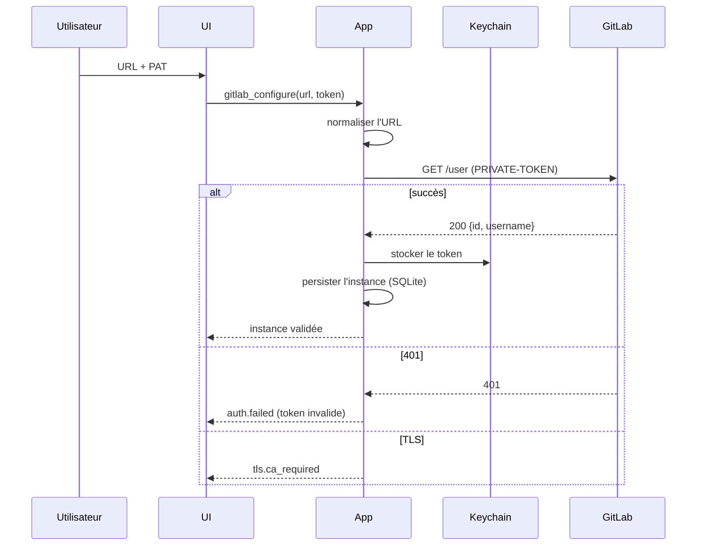

# 05 — Intégration GitLab self-hosted

## 1. Périmètre

### MVP (P0/P1)

- Configuration de l'URL de l'instance (préfixe de chemin inclus).
- Authentification par Personal Access Token.
- Stockage du token dans le keychain OS.
- Validation de la connexion.
- Liste et recherche des projets accessibles.
- Clonage SSH ou HTTPS.
- Association automatique dépôt local ↔ projet GitLab.
- Liste des merge requests.
- Détail d'une MR.
- Création d'une MR depuis une branche locale poussée.
- Ouverture d'une MR dans le navigateur.
- Statut des pipelines CI/CD.
- Badge MR/CI dans le graphe et la vue des branches.

### Après le MVP (P2)

- Commentaires inline et discussions.
- Approvals.
- Merge depuis l'application.
- Historique des pipelines et logs de jobs.
- Dashboard multi-dépôts.

### Hors périmètre

- Création de projets, gestion des membres, réglages d'instance.
- Import/export, wiki, snippets, releases.
- Plusieurs instances simultanées par profil.
- Mutations hors ligne mises en file.

## 2. Configuration et authentification

### Normalisation de l'URL

| Entrée | Base API | Base web |
|---|---|---|
| `https://gitlab.example.com` | `https://gitlab.example.com/api/v4` | `https://gitlab.example.com` |
| `https://example.com/gitlab` | `https://example.com/gitlab/api/v4` | `https://example.com/gitlab` |
| `https://example.com/gitlab/` | idem, slash final retiré | idem |

Règles :

- schéma `https` obligatoire par défaut ; `http` autorisé uniquement avec avertissement explicite et confirmation ;
- pas de slash final ;
- conserver le préfixe de chemin ;
- refuser une URL contenant des credentials (`user:pass@`) ;
- ne jamais construire une URL API par concaténation naïve sans encoder les segments.

### PAT

- Création : `https://<instance>/-/user_settings/personal_access_tokens` (GitLab récent) ou `/-/profile/personal_access_tokens` (ancien).
- Scopes requis : `api` + `read_user`.
- En-tête : `PRIVATE-TOKEN: <token>`.
- Validation : `GET /user` ; réponse attendue : `id`, `username`, `name`, `avatar_url`.
- Token stocké dans le keychain : service `beebranch.gitlab`, compte `<host>#<hash-url>`.
- Jamais dans SQLite, les logs, les URLs de remote, les crash reports ou le frontend.
- Expiration : un `401` déclenche `gitlab://auth-expired` ; l'utilisateur remplace le token ; aucune suppression automatique.

### TLS et réseau

- Vérification TLS toujours active.
- CA interne : import PEM dans les réglages, chargée en plus du trust store système.
- Proxy : support explicite via réglages (ou variables d'environnement standard), documenté.
- Erreur TLS : message contenant l'hôte, la cause et la procédure d'import du CA.
- Aucun mode « ignorer les certificats » au MVP.



## 3. Projets et association

### Liste et recherche

```text
GET /projects?membership=true&simple=true&per_page=100&order_by=last_activity_at&sort=desc
GET /projects?search=<q>&membership=true&simple=true&per_page=100
GET /groups/:id/projects?include_subgroups=true&per_page=100
```

- Pagination via `X-Next-Page` ; arrêt sur page vide ou plafond configuré.
- `simple=true` pour limiter la charge.
- Cache local TTL (5 min) ; invalidation manuelle.
- Le champ `id` numérique est utilisé pour les appels API ; `path_with_namespace` pour l'affichage.

### Association dépôt ↔ projet

Sources de vérité, par ordre de préférence :

1. Correspondance exacte avec `ssh_url_to_repo` ou `http_url_to_repo`.
2. Correspondance normalisée du chemin (`path_with_namespace`) et de l'hôte.
3. Association manuelle assistée (liste filtrée).

Normalisation des remotes :

| Forme | Extraction |
|---|---|
| `git@host:group/project.git` | host, `group/project` |
| `ssh://git@host:2222/group/project.git` | host, port, chemin |
| `https://host/group/project.git` | host, chemin |
| `https://host/gitlab/group/project.git` | préfixe + chemin |

- Le port SSH et le préfixe de chemin sont pris en compte.
- Les sous-groupes sont supportés.
- L'association est stockée dans SQLite et revalidée si le remote change.
- Un dépôt sans association reste pleinement utilisable ; l'UI propose « associer à un projet ».

## 4. Clonage

### HTTPS

- URL du remote enregistrée **sans token**.
- Credential helper fourni par l'application :
  - `git -c credential.helper= -c credential.helper=<helper> clone --progress <url> <path>` ;
  - le helper lit le token dans le keychain pour l'instance associée.
- Aucun token en argv, en URL ou dans `.git/config`.
- Si le helper échoue : `auth.failed` avec remédiation.

### SSH

- Utilise l'agent et `~/.ssh/config` existants.
- Aucune génération ni upload de clé au MVP.
- Échec `Permission denied (publickey)` → message avec vérification de `ssh -T git@host`.

### Après clonage

- Ouvrir la session de dépôt.
- Associer au projet.
- Proposer l'initialisation des submodules si présents (action explicite).

## 5. Merge requests

### Liste

```text
GET /projects/:id/merge_requests?state=opened&scope=<scope>&order_by=updated_at&sort=desc&per_page=50
GET /merge_requests?scope=created_by_me|assigned_to_me|reviews_for_me&state=opened&per_page=50
```

Scopes UI :

- « Mes MR » : `created_by_me`.
- « À reviewer » : `reviews_for_me`.
- « Assignées » : `assigned_to_me`.
- « Projet » : toutes les MR ouvertes du projet courant.

Champs utilisés : `iid`, `title`, `state`, `draft`, `source_branch`, `target_branch`, `author`, `assignees`, `reviewers`, `labels`, `detailed_merge_status`, `has_conflicts`, `sha`, `web_url`, `updated_at`, `user_notes_count`, `head_pipeline`.

### Détail

```text
GET /projects/:id/merge_requests/:iid
GET /projects/:id/merge_requests/:iid/diffs?per_page=50&page=1
GET /projects/:id/merge_requests/:iid/pipelines
```

- Les diffs proviennent de `/diffs` (jamais de `/changes`, déprécié depuis GitLab 15.7).
- Chaque entrée contient `old_path`, `new_path`, `new_file`, `renamed_file`, `deleted_file`, `generated_file`, `diff`.
- Le diff est du texte unifié ; le parseur de `crates/git` peut être réutilisé, sans exécuter Git.
- `overflow` / `real_size` : afficher un avertissement si le diff est tronqué par GitLab.
- Option d'exactitude : récupérer `refs/merge-requests/<iid>/head` et calculer le diff localement. À valider en P0 ; fallback API obligatoire.

### Création

```text
POST /projects/:id/merge_requests
  source_branch, target_branch, title, description,
  remove_source_branch, squash, allow_collaboration
```

- La branche source doit être poussée ; sinon message explicite.
- Draft : préfixe `Draft:` dans le titre (comportement GitLab).
- Template de description : lecture du template du projet si disponible (P2).
- Après création : rafraîchir la liste, associer la MR à la branche, afficher le badge.

### Merge / approvals (P2)

```text
PUT /projects/:id/merge_requests/:iid/merge
    sha, squash, merge_when_pipeline_succeeds, should_remove_source_branch
POST /projects/:id/merge_requests/:iid/approve
GET  /projects/:id/merge_requests/:iid/approvals
```

- `approvals` est Premium/Ultimate : `403`/`404` → fonctionnalité masquée, pas une erreur.
- `405 Method Not Allowed`, `406 Not Acceptable`, `409 Conflict` → messages spécifiques (conflit, pipeline requis, déjà mergée).
- Le merge exige le SHA courant pour éviter une course.

### Discussions (P2)

```text
GET  /projects/:id/merge_requests/:iid/discussions
POST /projects/:id/merge_requests/:iid/discussions
     body, position[base_sha|start_sha|head_sha|old_path|new_path|new_line|old_line]
```

- Les positions utilisent les SHAs de `diff_refs`.
- Une discussion peut être résolue via `PUT .../discussions/:discussion_id?resolved=true`.

## 6. Pipelines et CI

```text
GET /projects/:id/merge_requests/:iid/pipelines
GET /projects/:id/pipelines/:pipeline_id
GET /projects/:id/pipelines/:pipeline_id/jobs?per_page=100
GET /projects/:id/jobs/:job_id/trace
```

- La MR expose `head_pipeline` : `id`, `status`, `ref`, `sha`, `web_url`, `detailed_status`.
- Statuts mappés :

| GitLab | UI |
|---|---|
| `created`, `waiting_for_resource`, `preparing`, `pending` | en attente |
| `running` | en cours |
| `success` | succès |
| `failed` | échec |
| `canceled` | annulé |
| `skipped`, `manual`, `scheduled` | neutre / action requise |
| inconnu | inconnu (ne pas masquer) |

- Rafraîchissement : 30 s quand la vue MR est active et la fenêtre au premier plan ; pause sinon ; bouton manuel.
- Logs de jobs : P2, chargés à la demande, tronqués et paginés.

## 7. Cache, hors ligne et rafraîchissement

| Donnée | TTL | Invalidation |
|---|---|---|
| Identité utilisateur | session | 401 |
| Liste de projets | 5 min | manuelle, changement de token |
| Liste de MR | 60 s (vue active) | mutation, navigation |
| Détail MR | 60 s | idem |
| Diffs | 5 min | nouveau SHA de tête |
| Pipelines | 30 s (actif) | fin d'opération |

- Cache SQLite avec `ETag`, `Last-Modified`, `fetched_at`, `body` (quand l'endpoint fournit ces en-têtes ; sinon TTL seul).
- `If-None-Match` ; `304` réutilise le cache.
- Hors ligne :
  - toutes les opérations Git locales fonctionnent ;
  - les vues GitLab affichent les dernières données avec un bandeau « données du <date> » ;
  - aucune mutation GitLab n'est mise en file ;
  - les erreurs réseau ne bloquent jamais l'onglet dépôt.
- Au retour en ligne : rafraîchissement des vues actives, pas de tempête de requêtes (backoff + jitter).

## 8. Erreurs, retries et limites

| Code | Traitement |
|---|---|
| `401` | token invalide/expiré → événement d'auth, pas de retry |
| `403` | scope insuffisant ou fonctionnalité indisponible → message, feature off |
| `404` | ressource supprimée ou accès refusé → retirer du cache |
| `409` | conflit (merge, état) → message, rafraîchir |
| `422` | validation (branche, titre, source) → message de champ |
| `429` | `Retry-After` respecté, backoff, pas de boucle |
| `5xx` | retry GET avec backoff exponentiel + jitter, plafonné |
| Réseau/TLS | message classifié, pas de retry infini |

- Retries uniquement pour les requêtes **idempotentes** (`GET`, `HEAD`).
- Maximum 3 tentatives, délai de base 500 ms, plafond 8 s, jitter.
- Aucune requête GitLab dans le chemin critique d'une opération Git locale.

## 9. Modèle de données local

```sql
gitlab_instances(
  id TEXT PRIMARY KEY,
  base_url TEXT NOT NULL,
  api_url TEXT NOT NULL,
  display_name TEXT,
  ca_bundle_id TEXT,
  created_at TEXT NOT NULL
)

gitlab_identity(
  instance_id TEXT PRIMARY KEY REFERENCES gitlab_instances(id),
  user_id INTEGER NOT NULL,
  username TEXT NOT NULL,
  name TEXT,
  avatar_url TEXT,
  validated_at TEXT NOT NULL
)

gitlab_projects(
  instance_id TEXT NOT NULL,
  project_id INTEGER NOT NULL,
  path_with_namespace TEXT NOT NULL,
  name TEXT NOT NULL,
  web_url TEXT NOT NULL,
  ssh_url TEXT,
  http_url TEXT,
  default_branch TEXT,
  last_activity_at TEXT,
  fetched_at TEXT NOT NULL,
  etag TEXT,
  PRIMARY KEY (instance_id, project_id)
)

repo_project_links(
  repo_id TEXT PRIMARY KEY,
  instance_id TEXT NOT NULL,
  project_id INTEGER NOT NULL,
  match_kind TEXT NOT NULL,   -- url | path | manual
  verified_at TEXT NOT NULL
)

gitlab_cache(
  cache_key TEXT PRIMARY KEY,
  etag TEXT,
  body BLOB NOT NULL,
  fetched_at TEXT NOT NULL,
  expires_at TEXT
)
```

- Le token n'apparaît dans aucune table.
- Les corps de cache peuvent contenir des descriptions de MR ; le stockage est local et non chiffré au MVP, documenté.

## 10. Feature detection

| Fonctionnalité | Détection |
|---|---|
| Approvals | `GET .../approvals` → 200 ou 403/404 |
| Merge trains | champ `merge_trains_enabled` du projet |
| Logs de jobs | `GET .../trace` → 200 |
| Discussions positionnées | présence de `diff_refs` |
| Diffs | endpoint `/diffs` disponible |
| Version | en-tête `X-Gitlab-Version` (si présent) |

Les fonctionnalités indisponibles sont masquées, jamais remplacées par une erreur bloquante.

## 11. Sécurité

- Token dans le keychain uniquement ; accès via le backend.
- Redaction des en-têtes et des URLs avant tout log.
- Aucune valeur de token dans les messages d'erreur.
- TLS vérifié ; CA importée explicitement.
- Les liens externes sont ouverts dans le navigateur système via une allowlist de schémas (`https`).
- Les données GitLab ne sont jamais écrites dans le dépôt.
- Un changement d'URL d'instance invalide l'association et le cache ; le token reste lié à l'ancienne URL jusqu'à suppression explicite.

## 12. Tests

| Type | Contenu |
|---|---|
| Unitaire | normalisation d'URL, parsing de remote, mapping d'erreurs, pagination, feature detection |
| Contrat | client mocké (HTTP local) : 200/304/401/403/404/409/422/429/5xx |
| Intégration | instance GitLab de test (conteneur) : auth, projets, MR, diffs, pipelines |
| Sécurité | absence de token dans les logs, les URLs et les erreurs |
| Hors ligne | coupure réseau : Git local OK, vues GitLab en cache, aucune mutation en file |
| TLS | CA auto-signée acceptée uniquement si importée |
| Performance | temps de chargement d'une liste de 100 MR, pagination, taille IPC |
