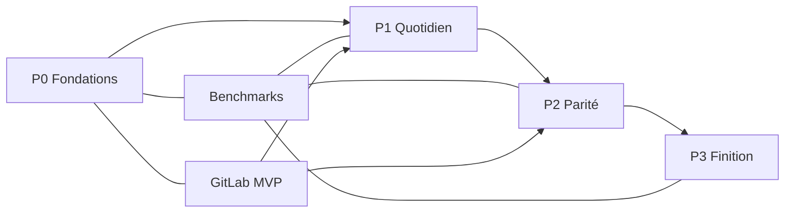

# 08 — Roadmap, dépendances et stratégie de tests

## 1. Vue d'ensemble

| Phase | Objectif | Critère de sortie |
|---|---|---|
| **P0** | Réduire les risques techniques | Démo mesurée sur dépôts réels + corpus ; graphe, diff, GitLab, reprise validés |
| **P1** | Remplacer GitKraken au quotidien | Un développeur fait une journée complète sans GitKraken ni terminal |
| **P2** | Parité fonctionnelle | Rebase interactif, conflits 3 panneaux, worktrees, blame, GitLab avancé |
| **P3** | Finition — livré | Undo complet, drag & drop, design system, gros dépôts, workspaces, accessibilité, distribution |

Les performances, la fiabilité et la sécurité ne sont pas des phases : elles sont vérifiées à chaque tâche.

## 2. Définition de terminé (DoD)

Une tâche n'est terminée que si :

1. Le comportement réel est implémenté, pas seulement l'interface.
2. Les critères d'acceptation de la fiche sont couverts.
3. Les cas d'erreur et les états intermédiaires sont traités.
4. Les tests unitaires et d'intégration passent sur les trois OS.
5. Aucun test existant n'est cassé ; aucune régression de performance au-delà du budget.
6. Les logs ne contiennent aucun secret.
7. La documentation de la tâche et, si nécessaire, l'ADR sont à jour.
8. Une preuve d'exécution est fournie (test, capture, rapport de benchmark).
9. Le diff ne contient aucun code mort, aucun `TODO` non justifié, aucune abstraction spéculative.

## 3. Stratégie de tests

### Pyramide

| Niveau | Contenu | Outils |
|---|---|---|
| Unitaire | parseurs, construction argv, mapping d'erreurs, normalisation d'URL, algorithmes de lanes | `cargo test`, `vitest` |
| Intégration | commandes Git réelles sur fixtures ; client GitLab sur serveur mocké | `cargo test`, `wiremock` |
| Contrat | types IPC, codes d'erreur stables, schémas GitLab | tests dédiés |
| E2E | ouverture de dépôt, staging, commit, MR, conflit | WebDriver Tauri ou harnais dédié |
| Performance | scénarios PERF-01..12 | `criterion`, harnais applicatif |
| Fault injection | kill, disque plein, permissions, verrou, réseau | tests dédiés |
| Plateforme | Windows, macOS, Linux | CI matrix |
| Sécurité | tokens, logs, TLS, XSS, chemins | tests dédiés + audit |

### Fixtures Git

Script versionné, déterministe, qui crée les dépôts décrits dans [03-git-engine §14](03-git-engine.md#14-tests). Les fixtures sont générées à la demande, pas committées.

### CI

| Étape | Déclencheur | Bloquant |
|---|---|---|
| `fmt` + `clippy -D warnings` | PR | oui |
| tests unitaires + intégration | PR | oui |
| typecheck + tests frontend | PR | oui |
| tests plateforme | PR (matrice) | oui |
| benchmarks réduits | PR | oui si régression > seuil |
| benchmarks complets + 1M commits | nightly | non bloquant, ticket obligatoire |
| audit dépendances | PR + nightly | oui sur vulnérabilité critique |
| tests de sécurité | PR | oui |
| E2E smoke | PR | oui |

### Preuves

Chaque PR de tâche fournit :

- la commande exécutée et sa sortie ;
- le résultat des tests ajoutés ;
- une mesure avant/après si la tâche touche un scénario de performance ;
- une capture ou un rapport pour les changements visuels.

## 4. P0 — Fondations

Détail des fiches : [tasks/p0.md](tasks/p0.md).

| ID | Tâche | Dépend de | Livrable |
|---|---|---|---|
| P0-T01 | Scaffold workspace, Tauri 2, CI 3 OS | — | application vide qui se lance, pipelines verts |
| P0-T02 | Couche processus Git | P0-T01 | `CommandSpec`, allowlist, capture, streaming, annulation |
| P0-T03 | Découverte et session de dépôt | P0-T02 | session worktree-aware, watcher, génération, état |
| P0-T04 | Modèle de lecture | P0-T03 | refs, status, log paginé, commit, diff parsé |
| P0-T05 | Prototype de graphe | P0-T04 | canvas virtualisé, lanes, 200k commits |
| P0-T06 | Prototype de diff | P0-T04 | hunk/inline/split, plafonds, mesure |
| P0-T07 | Socle GitLab | P0-T01 | config, keychain, validation, projets, CA |
| P0-T08 | Harnais de benchmark | P0-T02..T06 | corpus, scénarios, baseline, rapport |
| P0-T09 | Erreurs et reprise | P0-T02, P0-T03 | taxonomie, états, panneau de reprise |
| P0-T10 | Revue de sortie P0 | tous | démo, mesures, décision go/no-go |

**Critère de sortie :** les quatre risques majeurs (graphe, diff, GitLab/TLS, reprise) sont démontrés sur des dépôts réels, avec mesures publiées et aucun bloqueur non traité.

## 5. P1 — Quotidien

**État (0.2.0, 2026-10-27) :** implémenté et vérifié ; seule la validation humaine P1-T14 reste à exécuter. Voir [reviews/p1-review.md](reviews/p1-review.md).

Détail : [tasks/p1.md](tasks/p1.md).

| ID | Tâche | Dépend de |
|---|---|---|
| P1-T01 | Status et staging fichier/hunk/ligne | P0-T04, P0-T05 |
| P1-T02 | Commit et amend | P1-T01 |
| P1-T03 | Branches locales et distantes | P0-T04 |
| P1-T04 | Fetch / pull / push | P1-T03 |
| P1-T05 | Merge, rebase, conflits de base | P1-T03, P1-T04 |
| P1-T06 | Stash | P1-T01 |
| P1-T07 | Multi-dépôts | P0-T03 |
| P1-T08 | Recherche de commits | P0-T04 |
| P1-T09 | Interactions du graphe | P0-T05, P1-T03 |
| P1-T10 | GitLab — liste et création de MR | P0-T07 |
| P1-T11 | GitLab — pipelines et badge MR | P1-T10 |
| P1-T12 | Sécurité des actions destructives | P1-T01, P1-T03, P1-T05 |
| P1-T13 | Outils externes | P0-T01 |
| P1-T14 | Dogfooding et stabilisation | toutes |

**Critère de sortie :** trois développeurs volontaires travaillent une journée complète sans GitKraken ; les blocages restants sont documentés et planifiés.

## 6. P2 — Parité

**Statut : livré en 0.3.0.** Voir [docs/reviews/p2-review.md](reviews/p2-review.md).

Détail : [tasks/p2.md](tasks/p2.md).

| ID | Tâche | Dépend de |
|---|---|---|
| P2-T01 | Rebase interactif | P1-T05 |
| P2-T02 | Conflits 3 panneaux | P1-T05 |
| P2-T03 | Cherry-pick / revert avancés | P1-T05 |
| P2-T04 | Worktrees | P0-T03 |
| P2-T05 | Historique de fichier et blame | P0-T04 |
| P2-T06 | Command palette et raccourcis | P1 |
| P2-T07 | Recherche approfondie | P1-T08 |
| P2-T08 | GitLab — discussions inline | P1-T10 |
| P2-T09 | GitLab — approvals et merge | P1-T10 |
| P2-T10 | GitLab — jobs et logs | P1-T11 |
| P2-T11 | Submodules | P0-T03 |
| P2-T12 | Tags et remotes avancés | P1-T03 |
| P2-T13 | Profils | P1-T07 |
| P2-T14 | Patchs | P1-T01 |

## 7. P3 — Finition

Statut : **livré et vérifié** — preuves dans
[reviews/p3-review.md](reviews/p3-review.md). Détail : [tasks/p3.md](tasks/p3.md).

| ID | Tâche | Dépend de |
|---|---|---|
| P3-T01 | Undo / redo complet | P1-T12 |
| P3-T02 | Drag & drop avancé | P2-T01, P2-T03 |
| P3-T03 | Design system, thèmes, animations | P1 |
| P3-T04 | Optimisations gros dépôts | P0-T08 |
| P3-T05 | Workspaces multi-repos | P1-T07 |
| P3-T06 | Accessibilité | P2-T06 |
| P3-T07 | Distribution et mises à jour signées | P0-T01 |

## 8. Règles de découpage pour un agent

- Une fiche = une PR = un périmètre.
- Ne pas commencer une tâche dont les dépendances ne sont pas terminées.
- Ne pas modifier les fichiers hors périmètre.
- Ne pas créer d'abstraction non demandée.
- Ne pas ajouter de dépendance sans justification dans la PR.
- Ne pas marquer une tâche terminée sans preuve d'exécution.
- Si un critère d'acceptation est ambigu, s'arrêter et demander une décision ; ne pas inventer.
