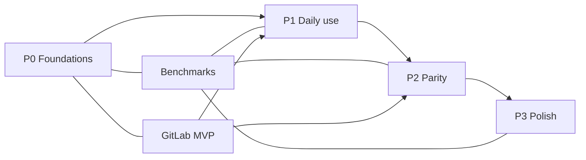
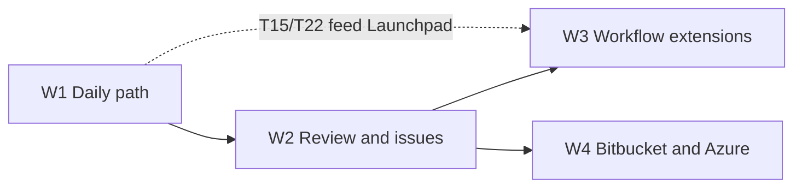

# 08 — Roadmap, dependencies, and testing strategy

## 1. Overview

| Phase | Objective | Exit criterion |
|---|---|---|
| **P0** | Reduce technical risks | Measured demo on real repositories + corpus; graph, diff, GitLab, recovery validated |
| **P1** | Replace the incumbent client for daily use | A developer works a full day without the incumbent client or a terminal |
| **P2** | Feature parity | Interactive rebase, 3-panel conflicts, worktrees, blame, advanced GitLab |
| **P3** | Polish — shipped | Complete undo, drag & drop, design system, large repositories, workspaces, accessibility, distribution |
| **P4** | Desktop parity — backlog | Every in-scope benchmark desktop feature at 100%, DoD met ([tasks/p4.md](tasks/p4.md)) |

Performance, reliability, and security are not phases: they are verified for every task.

## 2. Definition of Done (DoD)

A task is only complete if:

1. The actual behavior is implemented, not just the interface.
2. The task sheet's acceptance criteria are covered.
3. Error cases and intermediate states are handled.
4. Unit and integration tests pass on all three OSes.
5. No existing test is broken; no performance regression beyond the budget.
6. Logs contain no secrets.
7. The task documentation and, if necessary, the ADR are up to date.
8. Evidence of execution is provided (test, screenshot, benchmark report).
9. The diff contains no dead code, no unjustified `TODO`, no speculative abstraction.

## 3. Testing strategy

### Pyramid

| Level | Content | Tools |
|---|---|---|
| Unit | parsers, argv construction, error mapping, URL normalization, lane algorithms | `cargo test`, `vitest` |
| Integration | real Git commands on fixtures; GitLab client against a mocked server | `cargo test`, `wiremock` |
| Contract | IPC types, stable error codes, GitLab schemas | dedicated tests |
| E2E | repository opening, staging, commit, MR, conflict | Tauri WebDriver or dedicated harness |
| Performance | PERF-01..12 scenarios | `criterion`, application harness |
| Fault injection | kill, disk full, permissions, lock, network | dedicated tests |
| Platform | Windows, macOS, Linux | CI matrix |
| Security | tokens, logs, TLS, XSS, paths | dedicated tests + audit |

### Git fixtures

Versioned, deterministic script that creates the repositories described in [03-git-engine §14](03-git-engine.md#14-tests). Fixtures are generated on demand, not committed.

### CI

| Step | Trigger | Blocking |
|---|---|---|
| `fmt` + `clippy -D warnings` | PR | yes |
| unit + integration tests | PR | yes |
| typecheck + frontend tests | PR | yes |
| platform tests | PR (matrix) | yes |
| reduced benchmarks | PR | yes if regression > threshold |
| full benchmarks + 1M commits | nightly | non-blocking, ticket required |
| dependency audit | PR + nightly | yes for critical vulnerability |
| security tests | PR | yes |
| E2E smoke | PR | yes |

### Evidence

Each task PR provides:

- the command run and its output;
- the results of the added tests;
- a before/after measurement if the task affects a performance scenario;
- a screenshot or report for visual changes.

## 4. P0 — Foundations

Task sheet details: [tasks/p0.md](tasks/p0.md).

| ID | Task | Depends on | Deliverable |
|---|---|---|---|
| P0-T01 | Scaffold workspace, Tauri 2, 3-OS CI | — | empty application that launches, green pipelines |
| P0-T02 | Git process layer | P0-T01 | `CommandSpec`, allowlist, capture, streaming, cancellation |
| P0-T03 | Repository discovery and session | P0-T02 | worktree-aware session, watcher, generation, status |
| P0-T04 | Read model | P0-T03 | refs, status, paginated log, commit, parsed diff |
| P0-T05 | Graph prototype | P0-T04 | virtualized canvas, lanes, 200k commits |
| P0-T06 | Diff prototype | P0-T04 | hunk/inline/split, caps, measurement |
| P0-T07 | GitLab core | P0-T01 | config, OS keychain, validation, projects, CA |
| P0-T08 | Benchmark harness | P0-T02..T06 | corpus, scenarios, baseline, report |
| P0-T09 | Errors and recovery | P0-T02, P0-T03 | taxonomy, states, recovery panel |
| P0-T10 | P0 exit review | all | demo, measurements, go/no-go decision |

**Exit criterion:** the four major risks (graph, diff, GitLab/TLS, recovery) are demonstrated on real repositories, with published measurements and no unaddressed blockers.

## 5. P1 — Daily use

**Status (0.2.0, 2026-10-27):** implemented and verified; only human validation P1-T14 remains to be run. See [reviews/p1-review.md](reviews/p1-review.md).

Details: [tasks/p1.md](tasks/p1.md).

| ID | Task | Depends on |
|---|---|---|
| P1-T01 | Status and file/hunk/line staging | P0-T04, P0-T05 |
| P1-T02 | Commit and amend | P1-T01 |
| P1-T03 | Local and remote branches | P0-T04 |
| P1-T04 | Fetch / pull / push | P1-T03 |
| P1-T05 | Merge, rebase, basic conflicts | P1-T03, P1-T04 |
| P1-T06 | Stash | P1-T01 |
| P1-T07 | Multiple repositories | P0-T03 |
| P1-T08 | Commit search | P0-T04 |
| P1-T09 | Graph interactions | P0-T05, P1-T03 |
| P1-T10 | GitLab — MR listing and creation | P0-T07 |
| P1-T11 | GitLab — pipelines and MR badge | P1-T10 |
| P1-T12 | Destructive action safety | P1-T01, P1-T03, P1-T05 |
| P1-T13 | External tools | P0-T01 |
| P1-T14 | Dogfooding and stabilization | all |

**Exit criterion:** three volunteer developers work a full day without the incumbent client; remaining blockers are documented and scheduled.

## 6. P2 — Parity

**Status: shipped in 0.3.0.** See [docs/reviews/p2-review.md](reviews/p2-review.md).

Details: [tasks/p2.md](tasks/p2.md).

| ID | Task | Depends on |
|---|---|---|
| P2-T01 | Interactive rebase | P1-T05 |
| P2-T02 | 3-panel conflicts | P1-T05 |
| P2-T03 | Advanced cherry-pick / revert | P1-T05 |
| P2-T04 | Worktrees | P0-T03 |
| P2-T05 | File history and blame | P0-T04 |
| P2-T06 | Command palette and shortcuts | P1 |
| P2-T07 | Advanced search | P1-T08 |
| P2-T08 | GitLab — inline discussions | P1-T10 |
| P2-T09 | GitLab — approvals and merge | P1-T10 |
| P2-T10 | GitLab — jobs and logs | P1-T11 |
| P2-T11 | Submodules | P0-T03 |
| P2-T12 | Advanced tags and remotes | P1-T03 |
| P2-T13 | Profiles | P1-T07 |
| P2-T14 | Patches | P1-T01 |

## 7. P3 — Polish

Status: **shipped and verified** — evidence in
[reviews/p3-review.md](reviews/p3-review.md). Details: [tasks/p3.md](tasks/p3.md).

| ID | Task | Depends on |
|---|---|---|
| P3-T01 | Complete undo / redo | P1-T12 |
| P3-T02 | Advanced drag & drop | P2-T01, P2-T03 |
| P3-T03 | Design system, themes, animations | P1 |
| P3-T04 | Large repository optimizations | P0-T08 |
| P3-T05 | Multi-repository workspaces | P1-T07 |
| P3-T06 | Accessibility | P2-T06 |
| P3-T07 | Distribution and signed updates | P0-T01 |

## 8. P4 — Desktop parity backlog

**Status:** backlog — not started. Details: [tasks/p4.md](tasks/p4.md).

Scope: the benchmark desktop client's own documentation, minus everything that
depends on the vendor cloud or AI (cloud workspaces, cloud patches, code
suggestions, AI, MCP, agent sessions, team view, insights, SSO, on-premise
deployment). Cards are either **Finish** (behaviour exists but stops short) or
**Add** (behaviour absent). Sizes: S ≤ 2 d, M 3–5 d, L 1–2 w, XL > 2 w.

| Wave | Objective | Cards | Exit criterion |
|---|---|---|---|
| **W1** | Close the partial daily path | P4-T01…T16 | No terminal or external editor needed for the documented daily operations |
| **W2** | Review, providers, issues | P4-T17…T23 | A review runs end to end; every supported tracker is visible next to the repository |
| **W3** | Workflow extensions | P4-T24…T33 | Gitflow, LFS, terminal, Launchpad, deep links, WSL 2, conflict prevention, favourites, palette, accessibility |
| **W4** | Remaining providers | P4-T34…T36 | Bitbucket and Azure DevOps at GitHub/GitLab level; certificate management |

Invariant: every card meets the DoD of §2, including execution evidence, and
no card introduces a vendor account, telemetry or an AI dependency.

## 9. Task breakdown rules for an agent

- One task sheet = one PR = one scope.
- Do not start a task whose dependencies are not complete.
- Do not modify files outside the scope.
- Do not create an unrequested abstraction.
- Do not add a dependency without justification in the PR.
- Do not mark a task complete without evidence of execution.
- If an acceptance criterion is ambiguous, stop and request a decision; do not invent one.
